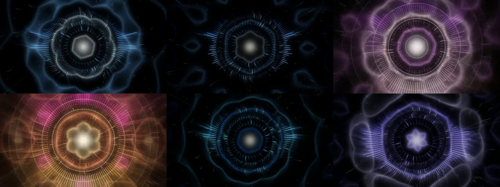
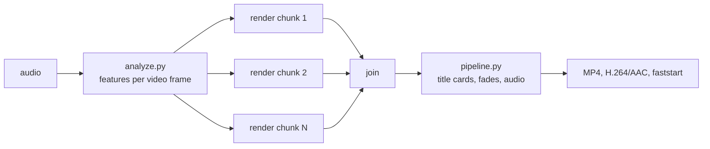

# yamba-music-visuals

Turn a song into an audio-reactive music video with one command.

The visuals aren't a template laid over the track: every frame is computed from the audio itself.
Rings pulse with the bass, a halo of 128 bars traces the spectrum, shockwaves fire on each hit, and
the colour palette travels from calm to intense as the music builds.



Made for **[Forgotten Mysteries (2007), Christopher Yamba](https://www.christopheryamba.com/music/)**.

## Quick start

Needs Python 3.10+ and `ffmpeg` on your PATH.

```bash
git clone https://github.com/cyamba/yamba-music-visuals
cd yamba-music-visuals
pip install -r requirements.txt
./scripts/get_fonts.sh            # optional: title-card fonts (Cinzel, Cormorant Garamond)

python -m musicviz song.mp3 -o video.mp4 \
  --title "Forgotten Mysteries" --artist "Christopher Yamba" --year 2007 \
  --tagline "More compositions from the past and future coming soon…" \
  --url "christopheryamba.com/music"
```

Try a 20-second window first, then render the whole thing:

```bash
python -m musicviz song.mp3 -o preview.mp4 --preview 130:150 --title "My Song"
```

### Options

| Flag | Default | What it does |
|---|---|---|
| `--size` | `1280x720` | Output size. `1920x1080`, or `1080x1920` for Shorts/Reels/TikTok |
| `--fps` | `30` | Frame rate |
| `--palette` | `mystery` | `mystery` (teal → violet → magenta/amber), `ember` (reds → gold), `abyss` (deep sea blues) |
| `--jobs` | CPU count | Parallel render processes |
| `--preview S:E` | full track | Render only seconds S to E |
| `--title --artist --year --tagline --url` | — | Text on the intro and outro cards |
| `--no-titles` | off | Skip the title cards |
| `--crf`, `--maxrate` | `23`, `1600k` | x264 quality and bitrate cap (`--maxrate none` for no cap) |
| `--work DIR` | temp | Keep intermediate files (features, chunks) |

Speed: about 0.2 s per 720p frame per core, so a 5-minute track takes about 15 minutes on two cores.

## How it works



**1. Listening (`analyze.py`).** The track is decoded and cut into one FFT window per video frame.
That gives a 64-band log spectrum plus bass, mid and high energy, loudness, and onset (kick) detection
via spectral flux. A slow "section" curve follows the song's overall intensity over about 8 seconds.
Band energies are normalised *adaptively*, against both the whole track and a rolling 15-second window,
so quiet passages still move and big moments still hit harder.

**2. Drawing (`render.py`).** Each frame is built from layers, back to front:

| Layer | Driven by |
|---|---|
| Feedback buffer: last frame zoomed, rotated and faded, giving tunnel trails | bass (zoom), mids (twist), section (trail length) |
| Kaleidoscopic lace: domain-warped interference ridges with 6-fold symmetry | mids, accumulated bass phase |
| Warp-speed starfield | loudness, section |
| Three counter-rotating rune rings | bass / mids / highs, one per ring |
| Spectrum halo: 128 mirrored radial bars | the 64-band spectrum |
| Shockwaves | detected kicks |
| Core orb, bloom, filmic tonemap, vignette | kicks, bass, section |

All motion runs on *cumulative* phases (the integral of energy over time). The visuals speed up with the
music but never jump.

**3. Rendering in parallel.** Apart from the feedback buffer, every frame is a pure function of its index.
So the track is split into chunks that render in parallel, and each chunk first renders a few seconds
before its start, unrecorded, to warm up its trails. That makes the joins invisible.

## Project layout

```
musicviz/
  analyze.py    audio → per-frame features (.npz)
  render.py     features → frames → video chunk (also runnable on its own)
  titles.py     intro/outro title cards (scale to landscape or vertical)
  pipeline.py   the one-command CLI: python -m musicviz
scripts/get_fonts.sh
```

To create your own look, add a palette to `PALETTES` in `render.py` (three gradients: calm, mid,
intense), or change the layer weights in `Viz.frame`.

## License

Code: MIT © 2026 Christopher Yamba. Fonts fetched by `get_fonts.sh` are under the SIL Open Font License.
The music isn't included in this repo and stays © its composer.
